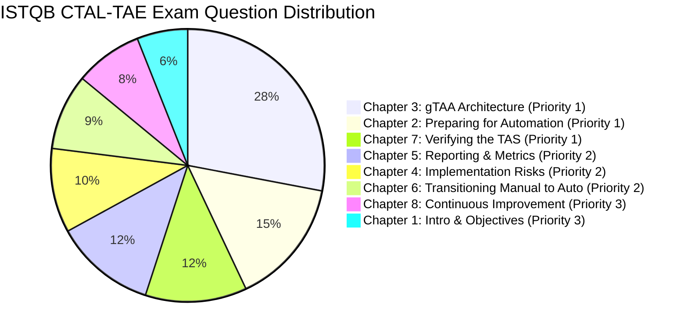
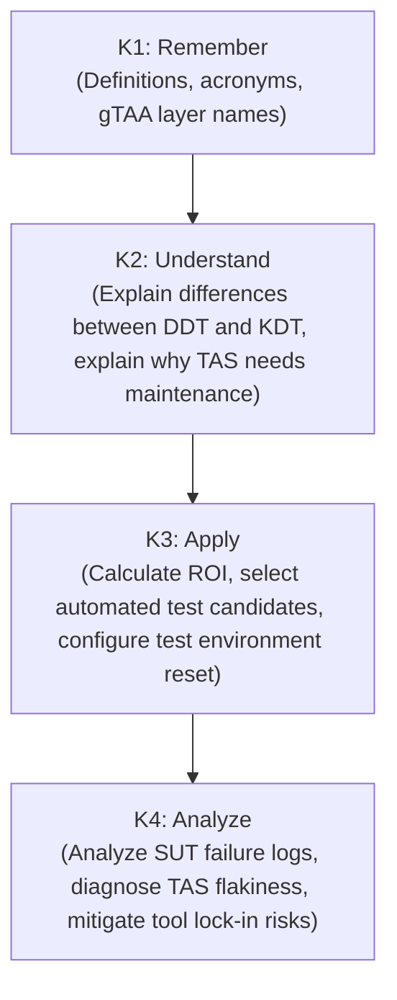
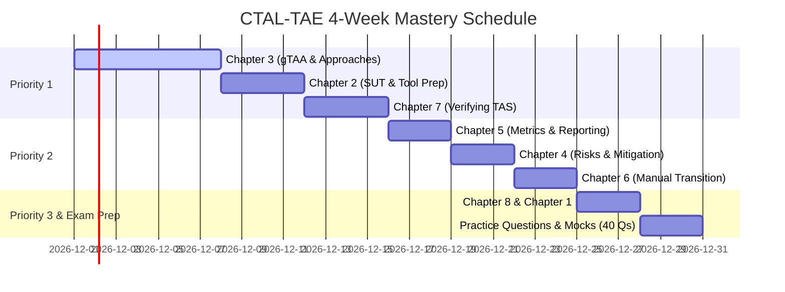

# 🧭 ISTQB CTAL-TAE: Study Instructions & Exam Blueprint

Welcome to the **ISTQB Certified Tester Advanced Level — Test Automation Engineer (CTAL-TAE)** study repository. This repository has been structured strictly according to the official ISTQB syllabus, organized by **Exam Weight Priority (Highest Scoring Topics First)**, packed with visual architecture diagrams, real-world framework code, and exam tips.

---

## 🎯 Exam Overview & Passing Criteria

| Attribute | Specification |
| :--- | :--- |
| **Exam Name** | ISTQB® Certified Tester Advanced Level — Test Automation Engineer (CTAL-TAE) |
| **Total Questions** | **40 multiple-choice questions** |
| **Passing Score** | **65% (26 out of 40 points)** |
| **Duration** | 90 minutes (113 minutes for non-native language candidates) |
| **Question Types** | Scenario-based analysis, evaluation, architecture matching, metric interpretation |
| **Cognitive Levels** | **K1** (Remember), **K2** (Understand), **K3** (Apply), **K4** (Analyze) |

> [!IMPORTANT]
> More than **70% of exam points** come from **K3 and K4** questions! You will not pass by memorizing definitions alone. You must be able to analyze SUT constraints, choose TAS architectures, evaluate pilot project risks, and select maintenance strategies.

---

## 📊 Exam Weight Distribution & Priority Order

To maximize your study efficiency, all notes are grouped into **three priority tiers** based on their weight in the official examination:

### 🔴 Priority 1: High Exam Weight (~55% of Exam — 21 to 24 Questions)
*Must master first. Heavy in K3 and K4 questions.*

| Chapter | Topic | Exam Focus | Points | Link |
| :---: | :--- | :--- | :---: | :--- |
| **Ch 3** | **Generic Test Automation Architecture (gTAA)** | 4 Layers (Generation, Definition, Execution, Adaptation), TAS vs TAF, Interfaces, Test Hooks | **9-11** | [Chapter 3 gTAA](docs/priority-1-high-weight/01-chapter3-gTAA-architecture.md) |
| **Ch 3** | **Automation Approaches & Design Patterns** | Data-Driven (DDT), Keyword-Driven (KDT), BDD, POM, Screenplay | Included in Ch 3 | [Approaches & Patterns](docs/priority-1-high-weight/02-chapter3-test-automation-approaches.md) |
| **Ch 2** | **Preparing for Test Automation** | SUT architecture analysis, tool evaluation, pilot projects, ROI calculation, feasibility | **5-6** | [Chapter 2 Preparing](docs/priority-1-high-weight/03-chapter2-preparing-for-automation.md) |
| **Ch 7** | **Verifying the TAS** | Verifying TAS environment, test suite determinism, false positives/negatives, test data reset | **4-5** | [Chapter 7 Verifying TAS](docs/priority-1-high-weight/04-chapter7-verifying-the-tas.md) |

---

### 🟡 Priority 2: Medium Exam Weight (~30% of Exam — 11 to 14 Questions)
*High return on investment; scenario-based questions.*

| Chapter | Topic | Exam Focus | Points | Link |
| :---: | :--- | :--- | :---: | :--- |
| **Ch 5** | **Test Automation Reporting & Metrics** | External/business metrics, internal TAS metrics, logging levels, diagnostic vs execution data | **4-5** | [Chapter 5 Metrics](docs/priority-2-medium-weight/05-chapter5-reporting-and-metrics.md) |
| **Ch 4** | **Implementation Risks & Contingencies** | Technical, process, and organizational risks; mitigation strategies; vendor lock-in | **4-5** | [Chapter 4 Risks](docs/priority-2-medium-weight/06-chapter4-risks-and-contingencies.md) |
| **Ch 6** | **Transitioning Manual to Automated** | Selection criteria for automation, dual-run strategies, regression pack candidate selection | **3-4** | [Chapter 6 Transition](docs/priority-2-medium-weight/07-chapter6-transitioning-manual-to-auto.md) |

---

### 🟢 Priority 3: Foundational Topics (~15% of Exam — 5 to 7 Questions)
*Foundational theory; predominantly K2 comprehension.*

| Chapter | Topic | Exam Focus | Points | Link |
| :---: | :--- | :--- | :---: | :--- |
| **Ch 8** | **Continuous Improvement of the TAS** | TAS maintenance, refactoring, deprecation, retirement, technical debt | **3-4** | [Chapter 8 Continuous Improvement](docs/priority-3-foundational/08-chapter8-continuous-improvement.md) |
| **Ch 1** | **Introduction & Objectives** | Purpose of test automation, success factors, limitations, realistic ROI expectations | **3-4** | [Chapter 1 Intro](docs/priority-3-foundational/09-chapter1-intro-and-objectives.md) |

---

## ⚡ Cognitive Knowledge Levels (K-Levels) Explained

Understanding K-levels is vital for passing the CTAL-TAE:

- **K1 (Remember):** You recognize a concept or term (e.g., *What does gTAA stand for?*).
- **K2 (Understand):** You can explain reasons, compare options, and categorize (e.g., *Why should the Test Adaptation Layer be decoupled from the Test Definition Layer?*).
- **K3 (Apply):** Given a concrete scenario, you implement or compute the correct action (e.g., *Given a 3-tier banking app with unstable UI, which interface should the TAS hook into?*).
- **K4 (Analyze):** You evaluate an entire situation, diagnose systemic flaws, and select the optimal architectural or risk mitigation strategy (e.g., *A team reports 30% false failures after a microservice update—what layer of the TAS is malfunctioning?*).

---

## 🤖 24/7 Cloud Daily Auto-Commit (Laptop-Free)

This repository includes an automated **GitHub Actions daily streak scheduler** located at [`.github/workflows/daily-study-tracker.yml`](.github/workflows/daily-study-tracker.yml).

### How It Works:
1. **Runs in GitHub Cloud:** Powered by GitHub's hosted runners.
2. **Laptop Independent:** Even if your laptop is closed, sleeping, or powered off, GitHub automatically triggers the workflow every single day at **06:00 UTC**.
3. **Daily Progress Log:** It runs [`scripts/daily_study_generator.py`](scripts/daily_study_generator.py), updates [`DAILY_STUDY_LOG.md`](DAILY_STUDY_LOG.md) with the daily study prompt, streak count, and exam flashcard, commits automatically, and pushes directly to `main`.
4. **No Manual Approval Needed:** Pushes are authenticated via GitHub Actions repository token.

---

## 📖 Recommended 4-Week Study Schedule

Let's begin! Start by reviewing **[Priority 1: Chapter 3 Generic Test Automation Architecture (gTAA)](docs/priority-1-high-weight/01-chapter3-gTAA-architecture.md)**.
