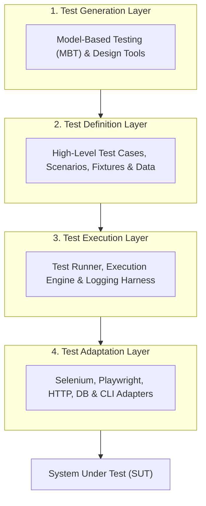
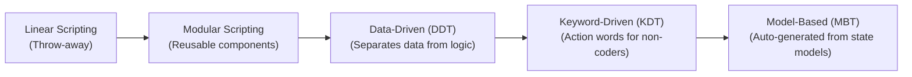
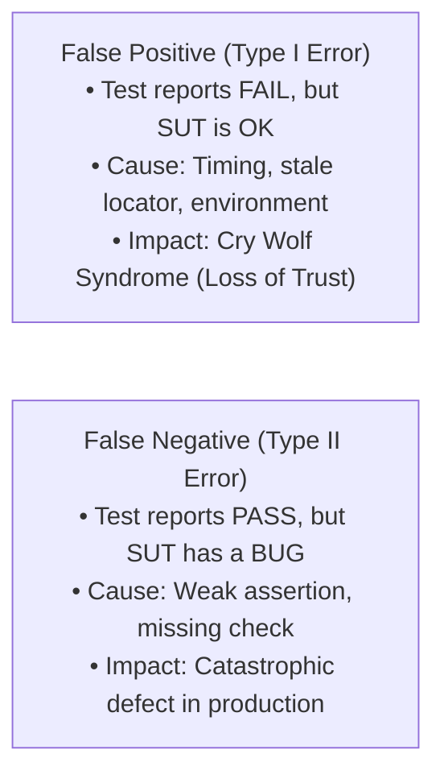

# 🎓 ISTQB CTAL-TAE: Complete All-in-One Master Guide
### Certified Tester Advanced Level — Test Automation Engineer Reference

This single document compiles the entire ISTQB CTAL-TAE syllabus into an illustrated, example-rich reference guide.

---

## Table of Contents
1. [Exam Blueprint & Priority Weighting](#1-exam-blueprint--priority-weighting)
2. [Chapter 3: Generic Test Automation Architecture (gTAA)](#2-chapter-3-generic-test-automation-architecture-gtaa)
3. [Chapter 3: Automation Approaches & Design Patterns](#3-chapter-3-automation-approaches--design-patterns)
4. [Chapter 2: Preparing for Test Automation](#4-chapter-2-preparing-for-test-automation)
5. [Chapter 7: Verifying the Test Automation Solution](#5-chapter-7-verifying-the-test-automation-solution)
6. [Chapter 5: Test Automation Reporting & Metrics](#6-chapter-5-test-automation-reporting--metrics)
7. [Chapter 4: Implementation Risks & Contingencies](#7-chapter-4-implementation-risks--contingencies)
8. [Chapter 6: Transitioning Manual to Automated Testing](#8-chapter-6-transitioning-manual-to-automated-testing)
9. [Chapter 8: Continuous Improvement of the TAS](#9-chapter-8-continuous-improvement-of-the-tas)
10. [Chapter 1: Introduction & Objectives for Automation](#10-chapter-1-introduction--objectives-for-automation)
11. [Master Glossary & K-Level Reference](#11-master-glossary--k-level-reference)

---

## 1. Exam Blueprint & Priority Weighting

| Priority Tier | Chapter | Topics | Questions | Focus Level |
| :---: | :--- | :--- | :---: | :---: |
| 🔴 **Priority 1** | **Chapter 3** | gTAA 4 Layers, TAS vs TAF, DDT/KDT, Adapters | **9-11** | K2, K3, K4 |
| 🔴 **Priority 1** | **Chapter 2** | SUT Analysis, Tool Evaluation, Pilot, ROI | **5-6** | K2, K3, K4 |
| 🔴 **Priority 1** | **Chapter 7** | Verifying TAS, Flakiness, False Alarms, Data | **4-5** | K2, K3 |
| 🟡 **Priority 2** | **Chapter 5** | Reporting, Metrics (Internal vs External), Logs | **4-5** | K2, K3 |
| 🟡 **Priority 2** | **Chapter 4** | Implementation Risks, Mitigation, Contingencies | **4-5** | K3, K4 |
| 🟡 **Priority 2** | **Chapter 6** | Transitioning Manual to Auto, Dual-Running | **3-4** | K2, K3 |
| 🟢 **Priority 3** | **Chapter 8** | Continuous Improvement, Refactoring, Debt | **3-4** | K2, K3 |
| 🟢 **Priority 3** | **Chapter 1** | Purpose, Success Factors, Limitations | **3-4** | K2 |

---

## 2. Chapter 3: Generic Test Automation Architecture (gTAA)

### The 4 Layers of gTAA

### Key Rules:
- **TAF (Framework):** Generic, reusable harness independent of the SUT.
- **TAS (Solution):** Concrete implementation tailored for a specific SUT.
- **Layer 4 (Adaptation):** Absorbs all UI, protocol, driver, and locator changes so business tests in Layer 2 remain untouched!

---

## 3. Chapter 3: Automation Approaches & Design Patterns

### Page Object Model (POM)
- Encapsulates UI locators and actions of a web page/screen in a dedicated class.
- Tests interact through methods (e.g. `loginPage.enterCredentials()`) and never directly touch raw XPaths or CSS selectors.

---

## 4. Chapter 2: Preparing for Test Automation

### PoC vs Pilot Project
- **Proof of Concept (PoC):** Short, 1-5 day technical experiment proving the tool can physically interact with tricky SUT components.
- **Pilot Project:** Multi-week trial on a real, non-critical project to establish standards, naming conventions, realistic effort estimates, and organizational fit.

### Calculating ROI
$$\text{ROI} = \frac{\text{Manual Savings} - \text{Total Automation Cost}}{\text{Total Automation Cost}} \times 100$$
- Automation is an upfront investment; initial cycles have a negative ROI until reaching the break-even point.

---

## 5. Chapter 7: Verifying the Test Automation Solution

### False Positives vs False Negatives

### Curing Test Flakiness:
- Never use `time.sleep()`; always use **explicit condition polling**.
- Ensure strict **test data isolation** (unique user accounts and database rollbacks).

---

## 6. Chapter 5: Test Automation Reporting & Metrics

| Internal Metrics (TAS Health) | External Metrics (Business Impact) |
| :--- | :--- |
| Execution Duration & Speed | Defects Caught by Automation |
| Flakiness / Intermittent Failure Rate | Release Cycle Time Reduction |
| False Positive Ratio | Cost Savings from Manual Hours Saved |
| Script Maintenance Effort (Hours/Sprint) | Production Defect Escape Rate |

---

## 7. Chapter 4: Implementation Risks & Contingencies
- **Technical Risks:** UI volatility, poor testability, vendor lock-in.
- **Process Risks:** Automating immature manual tests, lack of coding standards.
- **People Risks:** Unrealistic management expectations (100% automation myth), key engineer turnover.
- **Mitigation vs Contingency:** Mitigation is proactive planning done *before* an issue occurs; Contingency is the reactive playbook triggered *after* an issue occurs.

---

## 8. Chapter 6: Transitioning Manual to Automated Testing
- **What to Automate:** High-frequency regression runs, repetitive smoke tests, data-intensive combinations.
- **What to Keep Manual:** Usability, exploratory, aesthetic, and one-off tests.
- **Dual-Running:** Running manual and automated tests in parallel until the automated suite demonstrates stability, determinism, and zero unexplained failures.

---

## 9. Chapter 8: Continuous Improvement of the TAS
- **Refactoring:** Continuously eliminating duplication and upgrading locators.
- **Retiring Tests:** Safely removing obsolete automated tests when features are removed or redundant.
- **Technical Debt:** Allocating 15-20% of sprint capacity to maintain framework health.

---

## 10. Chapter 1: Introduction & Objectives for Automation
- **Primary Goal:** Enable fast, repeatable regression feedback without delaying sprint delivery.
- **Pesticide Paradox:** Repeating identical automated tests catches fewer new defects over time.
- **Success Factor:** Treating test automation with the same engineering rigor as production software development.

---

## 11. Master Glossary & K-Level Reference
For the full detailed glossary, review [docs/cheatsheets-and-exam-prep/11-exam-glossary-and-acronyms.md](docs/cheatsheets-and-exam-prep/11-exam-glossary-and-acronyms.md).
