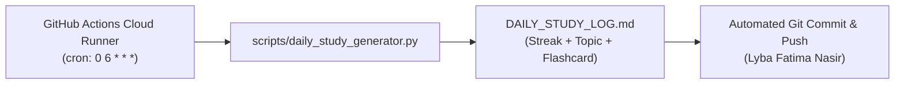
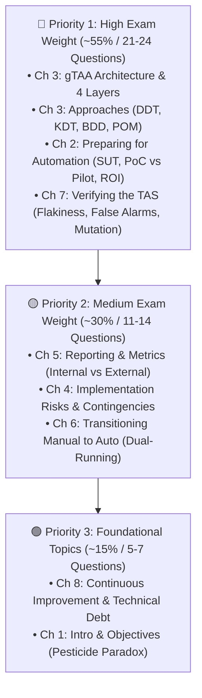

# 🏆 ISTQB CTAL-TAE Mastery Notes & Daily Study Tracker
### Certified Tester Advanced Level — Test Automation Engineer Complete Study Repository


An illustrated, scenario-rich study repository and automated daily learning engine designed to prepare candidates for the **ISTQB® Advanced Level Test Automation Engineer (CTAL-TAE)** certification exam.

---

## 🧭 Start Here: Instructions & Exam Blueprint
Before diving into individual chapters, read the master orientation guide:
👉 **[00-START-HERE-INSTRUCTIONS.md](00-START-HERE-INSTRUCTIONS.md)**  
*(Contains syllabus question distribution, K-level explanations, passing score rules, and study roadmaps)*

---

## 🤖 24/7 Cloud Daily Auto-Commit (Laptop-Free!)
This repository features an automated **GitHub Actions daily streak scheduler** running on a daily cron schedule directly in GitHub's cloud.



- **Works with Laptop Off:** Powered by GitHub Actions cloud infrastructure. Even if your laptop is closed, sleeping, or turned off, a new daily study prompt and flashcard is committed automatically every single day.
- **Track Your Streak:** Inspect your daily learning log in **[DAILY_STUDY_LOG.md](DAILY_STUDY_LOG.md)**!

---

## 📚 Study Notes: Ordered by Exam Weight

Topics are organized strictly from **highest exam points to foundational points**:



---

### 🔴 Priority 1: High Weight (~55% of Total Exam Points)
*Master these first. Dense in K3 and K4 scenario questions.*

| Chapter | Topic | Key Focus | Notes Link |
| :---: | :--- | :--- | :--- |
| **Ch 3** | **Generic Test Automation Architecture (gTAA)** | 4 Layers (Generation, Definition, Execution, Adaptation), TAS vs TAF vs SUT, Interface separation | [01-chapter3-gTAA-architecture.md](docs/priority-1-high-weight/01-chapter3-gTAA-architecture.md) |
| **Ch 3** | **Automation Approaches & Design Patterns** | Data-Driven (DDT), Keyword-Driven (KDT), BDD, Page Object Model (POM), Screenplay pattern | [02-chapter3-test-automation-approaches.md](docs/priority-1-high-weight/02-chapter3-test-automation-approaches.md) |
| **Ch 2** | **Preparing for Test Automation** | SUT architectural analysis, tool evaluation matrix, PoC vs Pilot Project, calculating ROI | [03-chapter2-preparing-for-automation.md](docs/priority-1-high-weight/03-chapter2-preparing-for-automation.md) |
| **Ch 7** | **Verifying the Test Automation Solution (TAS)** | Eliminating test flakiness, False Positives vs False Negatives, Mutation testing, Data isolation | [04-chapter7-verifying-the-tas.md](docs/priority-1-high-weight/04-chapter7-verifying-the-tas.md) |

---

### 🟡 Priority 2: Medium Weight (~30% of Total Exam Points)
*Crucial scenario-based analysis questions.*

| Chapter | Topic | Key Focus | Notes Link |
| :---: | :--- | :--- | :--- |
| **Ch 5** | **Test Automation Reporting & Metrics** | Internal vs External metrics, Diagnostic logs vs Execution logs, Stakeholder reporting | [05-chapter5-reporting-and-metrics.md](docs/priority-2-medium-weight/05-chapter5-reporting-and-metrics.md) |
| **Ch 4** | **Implementation Risks & Contingencies** | Technical, process, and people risks; risk mitigation matrix; preventing vendor lock-in | [06-chapter4-risks-and-contingencies.md](docs/priority-2-medium-weight/06-chapter4-risks-and-contingencies.md) |
| **Ch 6** | **Transitioning Manual to Automated Testing** | Criteria for automation, regression candidate selection matrix, Dual-Running strategy | [07-chapter6-transitioning-manual-to-auto.md](docs/priority-2-medium-weight/07-chapter6-transitioning-manual-to-auto.md) |

---

### 🟢 Priority 3: Foundational Topics (~15% of Total Exam Points)
*Foundational theory and core concepts.*

| Chapter | Topic | Key Focus | Notes Link |
| :---: | :--- | :--- | :--- |
| **Ch 8** | **Continuous Improvement of the TAS** | Refactoring, managing automation technical debt, retiring and deprecating obsolete tests | [08-chapter8-continuous-improvement.md](docs/priority-3-foundational/08-chapter8-continuous-improvement.md) |
| **Ch 1** | **Introduction & Objectives for Test Automation** | Automation purposes, advantages, limitations, success factors, Pesticide Paradox | [09-chapter1-intro-and-objectives.md](docs/priority-3-foundational/09-chapter1-intro-and-objectives.md) |

---

## 🗂️ Cheatsheets, Glossaries & Practice Exams

- 📋 **[All K-Level Learning Objectives Matrix](docs/cheatsheets-and-exam-prep/10-all-k-level-learning-objectives.md)**: Full list of all 43 syllabus learning objectives.
- 📖 **[Official Exam Glossary & Acronyms](docs/cheatsheets-and-exam-prep/11-exam-glossary-and-acronyms.md)**: Official definitions for SUT, TAF, TAS, gTAA, Test Hooks, Flakiness, etc.
- 🧪 **[Sample Exam Practice Questions & Rationales](docs/cheatsheets-and-exam-prep/12-sample-exam-practice-questions.md)**: Scenario-based mock exam questions with in-depth answer explanations.
- 📘 **[Complete All-in-One Master Guide](CTAL_TAE_COMPLETE_MASTER_GUIDE.md)**: Single consolidated offline handbook covering every topic.

---

## 📜 Repository Structure

```text
istqb-ctal-tae-notes/
├── .github/
│   └── workflows/
│       └── daily-study-tracker.yml             # Daily cloud automated commit workflow
├── scripts/
│   ├── daily_study_generator.py                # Python daily study generator (GitHub Actions)
│   └── daily_study_generator.ps1               # PowerShell daily study generator (Windows)
├── 00-START-HERE-INSTRUCTIONS.md               # Syllabus guide, exam weightage, study plan
├── DAILY_STUDY_LOG.md                          # Living daily study streak log
├── CTAL_TAE_COMPLETE_MASTER_GUIDE.md           # Consolidated all-in-one offline guide
├── README.md                                   # Master navigation & visual index
└── docs/
    ├── priority-1-high-weight/                 # ~55% of exam points
    │   ├── 01-chapter3-gTAA-architecture.md
    │   ├── 02-chapter3-test-automation-approaches.md
    │   ├── 03-chapter2-preparing-for-automation.md
    │   └── 04-chapter7-verifying-the-tas.md
    ├── priority-2-medium-weight/               # ~30% of exam points
    │   ├── 05-chapter5-reporting-and-metrics.md
    │   ├── 06-chapter4-risks-and-contingencies.md
    │   └── 07-chapter6-transitioning-manual-to-auto.md
    ├── priority-3-foundational/                # ~15% of exam points
    │   ├── 08-chapter8-continuous-improvement.md
    │   └── 09-chapter1-intro-and-objectives.md
    └── cheatsheets-and-exam-prep/
        ├── 10-all-k-level-learning-objectives.md
        ├── 11-exam-glossary-and-acronyms.md
        └── 12-sample-exam-practice-questions.md
```

---

## 🎓 Exam Day Advice
1. **Focus on K3 and K4:** Scenario analysis questions carry the most points. Pay close attention to gTAA layer responsibilities and tool evaluation pilot rules.
2. **Beware of Absolutes:** Options containing words like *"always"*, *"never"*, or *"automate 100% of all tests"* are almost always incorrect distractors.
3. **Remember Layer 4:** Whenever a question mentions changing third-party tools, databases, or UI frameworks, the impact is absorbed by the **Test Adaptation Layer**.

Good luck on your ISTQB CTAL-TAE certification journey! 🚀
