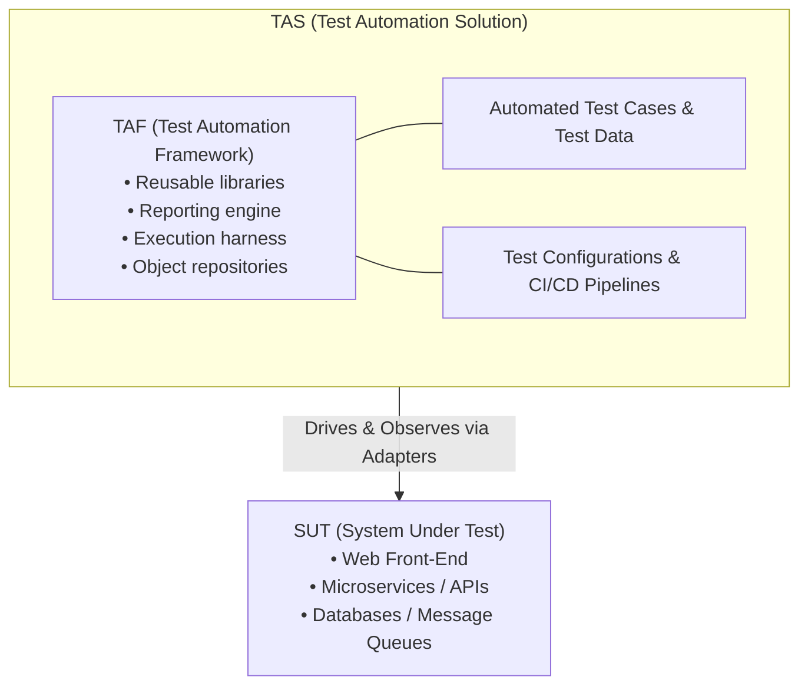
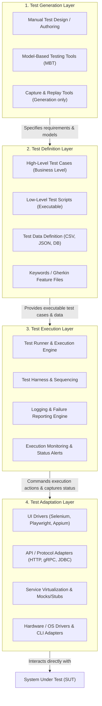
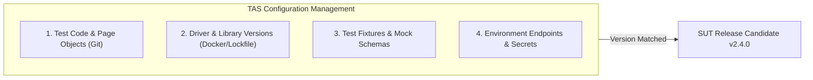

# 🏛️ Priority 1: Chapter 3 — Generic Test Automation Architecture (gTAA)

> **Exam Weight:** 🔴 **HIGHEST (~9-11 Questions / 25-28% of Total Exam)**  
> **Cognitive Level:** **K2, K3, K4** (Multiple architectural scenario analysis questions)

---

## 🎯 What You'll Learn
1. The formal definitions and boundaries of **SUT**, **TAF**, and **TAS**.
2. The **4 Layers of gTAA** and the specific responsibilities of each layer.
3. How information and control flow across the layer boundaries.
4. How to diagnose layer-coupling anti-patterns and answer K4 exam scenarios.
5. Configuration management and test environment dependencies for the TAS.

---

## 1. Core Definitions: SUT vs TAF vs TAS

One of the most frequently tested concepts on the CTAL-TAE exam is the precise distinction between these three terms:



| Term | Full Name | Definition | Scope |
| :--- | :--- | :--- | :--- |
| **SUT** | **System Under Test** | The application, system, or software component being tested. | External to the testing solution. |
| **TAF** | **Test Automation Framework** | The reusable architectural structure, harness, design rules, and toolset providing generic automation capabilities. | The framework itself—independent of specific test case logic. |
| **TAS** | **Test Automation Solution** | The **complete operational implementation** combining the TAF, the concrete test cases, test data, scripts, and integration with the SUT environment. | The living, deployed automated testing ecosystem. |

> [!IMPORTANT]
> **Exam Tip (K2/K3):** The TAF should be **independent of the SUT** and reusable across multiple applications. The TAS is the tailored implementation configured for a *specific* SUT.

---

## 2. The 4 Layers of gTAA (Generic Test Automation Architecture)

The ISTQB gTAA defines four distinct architectural layers. Each layer has strict responsibilities to ensure **maintainability**, **modularity**, and **independence from technological changes**.



---

### Detailed Layer Breakdown

#### Layer 1: Test Generation Layer
- **Purpose:** Supports the design and generation of tests and test data.
- **Components:**
  - Model-Based Testing (MBT) engines (generating paths from state diagrams).
  - Test case specification tools.
  - Recording/capture tools (generating draft tests).
- **Exam Rule:** Output from this layer is handed over to the *Test Definition Layer*.

#### Layer 2: Test Definition Layer
- **Purpose:** Defines the concrete test cases, test suites, and test data specifications.
- **Key Artifacts:**
  - High-level test definitions (e.g., Cucumber `.feature` files, Keyword tables).
  - Low-level test scripts (e.g., Python `pytest` functions, JUnit classes).
  - Test data repositories (CSV, database fixtures, factory objects).
- **Exam Rule:** Isolates test logic from communication protocols! If the UI changes from Web to Mobile, tests in Layer 2 should **not** change.

#### Layer 3: Test Execution Layer
- **Purpose:** Controls the execution, orchestration, sequencing, and logging of test runs.
- **Components:**
  - **Test Runner:** Orchestrates suite execution, retries, and parallel threading.
  - **Test Harness:** Sets up and tears down environments, initializes mocks, seeds databases.
  - **Logging Engine:** Records raw test results, execution durations, diagnostic traces.
- **Exam Rule:** Layer 3 does NOT directly speak to the SUT! It delegates communication to Layer 4.

#### Layer 4: Test Adaptation Layer
- **Purpose:** Provides the translation layer between generic test commands and the SUT's concrete interfaces.
- **Components:**
  - **Adapters & Drivers:** Selenium WebDriver, Playwright, REST Client (`requests`, `HttpClient`), SSH/CLI connectors, Database adapters.
  - **Test Hooks / Simulators:** Internal hooks compiled into the SUT, virtualized third-party services.
- **Exam Rule (Crucial for K4):** All technology-specific protocols live strictly in Layer 4. If an HTTP library changes or a UI framework upgrades from React to Vue, **only Layer 4 adapters are modified**.

---

## 3. Real-World Code Mapping to gTAA

Here is how a modern, production-grade test suite maps directly onto the gTAA layers:

```python
# ==============================================================================
# LAYER 2: TEST DEFINITION LAYER
# Pure business logic and assertions. No browser clicks or raw HTTP calls!
# ==============================================================================
def test_user_can_purchase_premium_subscription(login_page, checkout_page):
    # High-level test definition
    login_page.login_as_standard_user()
    checkout_page.select_plan("PREMIUM")
    checkout_page.confirm_payment()
    
    assert checkout_page.get_order_status() == "CONFIRMED"


# ==============================================================================
# LAYER 4: TEST ADAPTATION LAYER
# Low-level interface adaptation. Encapsulates Selenium/Playwright locators.
# ==============================================================================
class CheckoutPageAdapter:
    def __init__(self, driver):
        self.driver = driver  # Concrete driver (Layer 4)

    def select_plan(self, plan_name):
        # Translates generic business action to browser-specific DOM interaction
        element = self.driver.find_element("id", f"plan-select-{plan_name.lower()}")
        element.click()

    def confirm_payment(self):
        self.driver.find_element("css selector", "button#btn-confirm-pay").click()

    def get_order_status(self):
        return self.driver.find_element("id", "order-status-badge").text
```

---

## 4. Configuration Management in the TAS

The TAS is a software development project in its own right. It requires rigorous configuration management covering:
1. **Test Scripts & Source Code:** Git version control aligned with SUT release branches.
2. **Test Tools & Dependencies:** Explicit lockfiles (`package-lock.json`, `poetry.lock`, Docker images).
3. **Test Data Fixtures:** Seed data schemas versioned with database migrations.
4. **Environment Configurations:** Base URLs, API keys, credentials stored in secure secret stores (not hardcoded).



---

## 5. ❓ Typical Exam Scenarios & Traps (K3/K4 Analysis)

### 🚨 Scenario 1: Tight Coupling Anti-Pattern
> **Question:** A team implemented an automated test suite where test scripts directly contain XPath locators, SQL queries, and HTTP REST calls mixed into the test assertions. When the database schema changed, 80% of test scripts failed. Which gTAA principle was violated?
>
> **Correct Answer:** **Violation of separation between Test Definition Layer and Test Adaptation Layer.** Test scripts (Layer 2) must interact with reusable page objects or database adapters (Layer 4). Data retrieval details should never be hardcoded in test scripts.

---

### 🚨 Scenario 2: SUT vs TAF Responsibility
> **Question:** During a major SUT UI redesign, which of the following components should remain untouched if the TAS follows the gTAA reference model correctly?
>
> A) Test Adaptation Layer  
> B) Page Object locators  
> C) High-level test scenarios in the Test Definition Layer  
> D) Browser drivers  
>
> **Correct Answer:** **C.** The business-level test cases (e.g., "User logs in with valid credentials") do not change when the UI redesign occurs. Only the adaptation layer (locators, adapters) is updated.

---

## 📝 Key Takeaways for the Exam
- [ ] **gTAA has 4 layers:** Generation, Definition, Execution, Adaptation.
- [ ] **TAF** is the generic framework; **TAS** is the specific implementation for an SUT.
- [ ] **Layer 4 (Adaptation)** absorbs all protocol, technology, and tool changes.
- [ ] **Layer 2 (Definition)** contains business logic and should survive UI refactors.
- [ ] **Layer 3 (Execution)** handles scheduling, harness setup, and execution logs.
