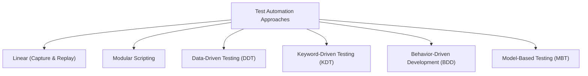
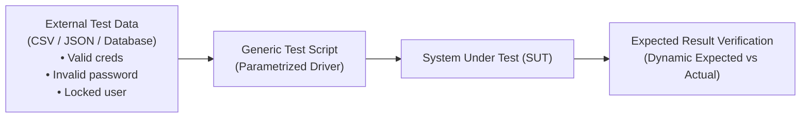
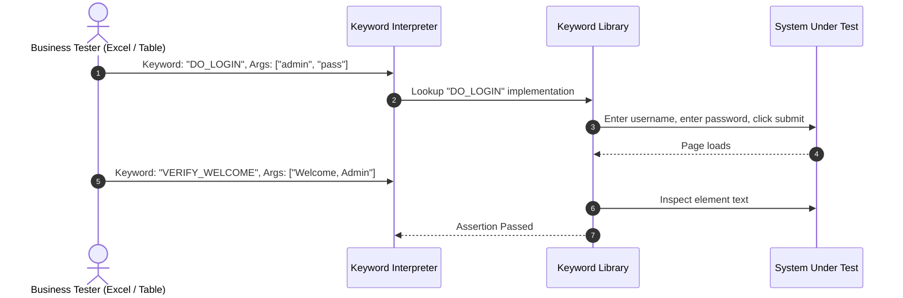
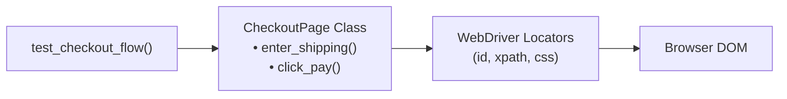

# 🛠️ Priority 1: Chapter 3 — Test Automation Approaches & Design Patterns

> **Exam Weight:** 🔴 **HIGHEST (~Part of Chapter 3's 9-11 Questions)**  
> **Cognitive Level:** **K2, K3, K4** (Comparing approaches, recommending suitable framework designs)

---

## 🎯 What You'll Learn
1. The 6 core automation approaches: **Capture/Replay**, **Modular**, **Data-Driven (DDT)**, **Keyword-Driven (KDT)**, **Behavior-Driven (BDD)**, and **Model-Based (MBT)**.
2. Architectural differences, implementation trade-offs, and cost-of-maintenance profiles.
3. Essential design patterns: **Page Object Model (POM)**, **Screenplay Pattern**, and **Factory Pattern**.
4. How to select the optimal approach based on team skillset and SUT volatility.

---

## 1. Overview of Test Automation Approaches



---

## 2. Deep Dive: The 6 Approaches

### 1. Linear Scripting (Capture & Replay / Record & Playback)
- **Concept:** Tester manually records actions using a capture tool, generating a single procedural script.
- **Pros:** Fast initial setup; requires zero programming knowledge.
- **Cons:** **Extremely high maintenance cost**. Any minor UI change (e.g., button ID, label) breaks all recorded scripts. No reusability.
- **Exam Rule:** Suitable **only** for temporary throw-away tests or initial exploratory baselining. Never acceptable for long-term regression suites!

---

### 2. Modular Scripting
- **Concept:** Individual test cases are split into independent, reusable modules (e.g., `loginModule()`, `selectProductModule()`, `logoutModule()`).
- **Pros:** Modularity reduces duplication. Changes to login flow are fixed in one module.
- **Cons:** Test data is still largely embedded in the code or scripts.

---

### 3. Data-Driven Testing (DDT)
- **Concept:** **Separates test logic from test data**. The identical test script executes repeatedly against multiple rows of external data (CSV, JSON, Database, Excel).



**Code Example (pytest / DDT):**
```python
import pytest

# Test logic written ONCE; executed 3 times with different inputs and expected statuses
@pytest.mark.parametrize("username,password,expected_status,expected_code", [
    ("valid_user",   "Secret123!", "AUTHORIZED", 200),
    ("locked_user",  "Secret123!", "LOCKED",     403),
    ("unknown_user", "WrongPass",  "NOT_FOUND",  401),
])
def test_authentication_scenarios(api_client, username, password, expected_status, expected_code):
    response = api_client.post("/login", json={"user": username, "pass": password})
    assert response.status_code == expected_code
    assert response.json()["status"] == expected_status
```

---

### 4. Keyword-Driven Testing (KDT / Action-Word Testing)
- **Concept:** Tests are written as sequences of **high-level action words (keywords)** with associated arguments. A specialized **Keyword Interpreter** translates the keywords into executable actions.
- **Who Writes Tests?** Non-technical subject matter experts (business analysts, manual testers).
- **Who Builds the Framework?** Automation engineers write the underlying keyword handlers.



**Keyword Table Example:**
| Test Case ID | Step | Keyword | Argument 1 | Argument 2 |
| :--- | :---: | :--- | :--- | :--- |
| **TC_CHECKOUT_01** | 1 | `LAUNCH_APP` | `https://shop.local` | — |
| | 2 | `LOGIN` | `test_customer` | `P@ssword1` |
| | 3 | `ADD_ITEM` | `SKU-8821` | `Quantity=2` |
| | 4 | `ASSERT_CART_TOTAL` | `$199.98` | — |

---

### 5. Behavior-Driven Development (BDD)
- **Concept:** Uses human-readable domain-specific language (**Gherkin syntax**: `Given`, `When`, `Then`) to bridge communication between stakeholders, developers, and QA.

```gherkin
Feature: Cart Checkout Calculation

  Scenario: Bulk order discount applied
    Given a customer with "Gold" loyalty tier
    When the customer adds 5 units of "Product-400" to the shopping cart
    Then the unit price should be discounted by 15%
    And the order summary shows free shipping
```

---

### 6. Model-Based Testing (MBT)
- **Concept:** Test cases are automatically generated from a formal mathematical model (Finite State Machine, State Transition Diagram, or Decision Table) of the SUT.
- **Benefit:** When SUT specifications change, updating the single state model automatically regenerates all test cases across all valid paths!

---

## 3. Comprehensive Approaches Comparison Matrix

| Approach | Initial Setup Cost | Maintenance Effort | Technical Skill Required | Reusability |
| :--- | :---: | :---: | :---: | :---: |
| **Linear (Record/Playback)** | Very Low | **Extremely High** | None | Nil |
| **Modular** | Low | Medium | Medium | Medium |
| **Data-Driven (DDT)** | Medium | Low | Medium | High |
| **Keyword-Driven (KDT)** | **High** | **Low** | Low (for authors), High (for engine devs) | **Very High** |
| **BDD (Gherkin)** | Medium-High | Medium | Low-Medium | High |
| **Model-Based (MBT)** | **Very High** | **Very Low** | **Very High** | **Maximum** |

---

## 4. Test Automation Design Patterns

### A. Page Object Model (POM)
- Encapsulates UI locators and user interactions for a single page or component into an object class.
- **Rule:** Test cases call methods on the Page Object; test cases **never** touch locators or driver calls directly.



### B. Screenplay Pattern (Actors, Tasks, Interactions)
- Replaces POM on large, enterprise test architectures to avoid monolithic page objects.
- **Components:**
  - **Actor:** The user persona (*"Customer"*, *"Admin"*).
  - **Ability:** What the actor can do (*"Browse the web with Chrome"*, *"Call REST API"*).
  - **Task:** High-level business goal (*"Place an Order"*).
  - **Interaction:** Atomic action (*"Click the checkout button"*).
  - **Question:** An assertion inspecting state (*"What is the displayed total?"*).

---

## 5. ❓ Typical Exam Scenarios (K3/K4)

### 🚨 Scenario 1: Selecting an Automation Approach
> **Scenario:** A software company has 12 manual testers with extensive domain knowledge but **zero programming experience**. Management demands that these testers write and maintain automated regression tests. The automation architect must design a framework to support this.
>
> **Which approach is best suited?**  
> A) Linear Scripting (Record and Playback)  
> B) Keyword-Driven Testing (KDT)  
> C) Modular Code Scripting in Java  
> D) Model-Based Testing with state machines  
>
> **Correct Answer:** **B (Keyword-Driven Testing)**. KDT allows non-technical testers to author test cases using tables of predefined keywords, while technical engineers build and maintain the underlying keyword action library.

---

### 🚨 Scenario 2: High Maintenance Troubleshooting
> **Scenario:** An organization implemented automated UI tests where test scripts grew to 500 files. A small change to the navigation menu layout required updating 450 test files individually, halting sprint delivery.
>
> **What design pattern would have prevented this failure?**  
> **Correct Answer:** **Page Object Model (POM) or Component Object Model.** By centralizing the navigation menu locators in a single shared Page/Component Object class, only that single class would require updating when the menu changes.
