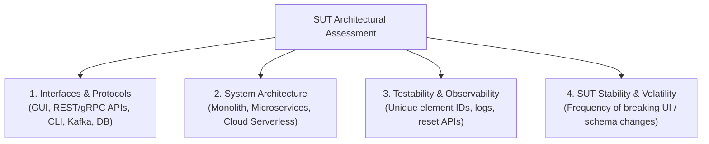
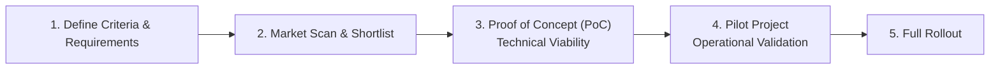
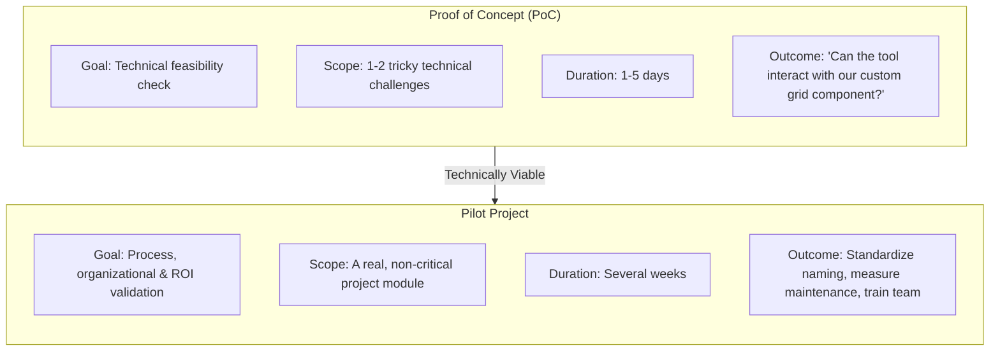
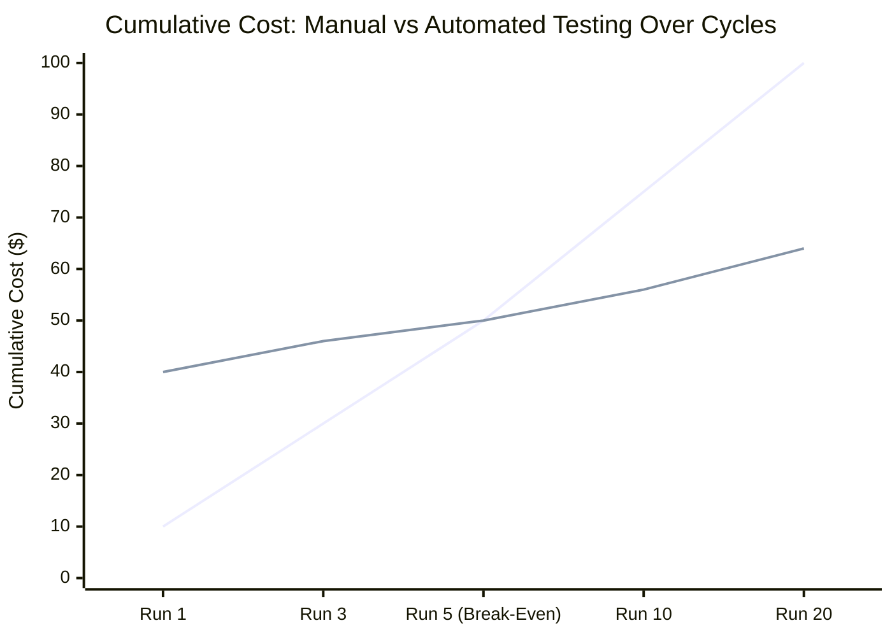

# 📋 Priority 1: Chapter 2 — Preparing for Test Automation

> **Exam Weight:** 🔴 **HIGH (~5-6 Questions / ~15% of Total Exam)**  
> **Cognitive Level:** **K2, K3, K4** (Tool evaluation, ROI calculation, Pilot Project design)

---

## 🎯 What You'll Learn
1. How to analyze SUT architectural characteristics and **Design for Testability**.
2. The rigorous **Tool Evaluation Process** and selection criteria.
3. The exact difference between a **Proof of Concept (PoC)** and a **Pilot Project**.
4. How to calculate and justify **Return on Investment (ROI)** for test automation.
5. Key testability attributes: **Observability**, **Controllability**, and **Test Hooks**.

---

## 1. SUT Factors Influencing Automation

Before writing a single automation script, the Test Automation Engineer (TAE) must evaluate the **System Under Test (SUT)** across four architectural dimensions:

### Key Testability Characteristics
- **Controllability:** The ability to put the SUT into a defined initial state (e.g., seeding a clean database via an API or SQL script before running tests).
- **Observability:** The ability to inspect SUT internal states, outputs, and intermediate events (e.g., structured error logs, health-check endpoints, message queue monitors).
- **Test Hooks:** Special programmatic interfaces or bypass mechanisms built into the SUT specifically to facilitate automation (e.g., an endpoint to bypass SMS two-factor authentication in staging environments).

> [!WARNING]
> **Exam Trap (K4):** If the SUT UI is rapidly changing and highly volatile, **do NOT automate through the UI**. Shift automation down to the API/service layer where interfaces are contractually stable.

---

## 2. Tool Evaluation & Selection Process

Never select an automation tool based purely on marketing or popularity. ISTQB mandates a structured evaluation process:

### Evaluation Criteria Matrix

| Dimension | Evaluation Factors |
| :--- | :--- |
| **Technical** | Support for SUT platforms/technologies, testability hooks, reporting capabilities, CI/CD integration, parallel execution. |
| **Organizational** | Team programming skills, ramp-up time, documentation quality, user community size. |
| **Commercial / Cost** | License fees, support contracts, hardware/cloud infrastructure requirements. |
| **Vendor / Ecosystem** | Vendor financial stability, frequency of tool updates, migration/export capability (avoiding vendor lock-in). |

---

## 3. Proof of Concept (PoC) vs Pilot Project

This is **one of the most heavily tested distinctions on the exam**:

| Characteristic | Proof of Concept (PoC) | Pilot Project |
| :--- | :--- | :--- |
| **Core Purpose** | Validates **technical feasibility** (Can it work?). | Validates **process, cost, guidelines, and organization** (How will we work?). |
| **Scope** | Tiny, isolated technical prototype. | Real application feature (non-critical, representative). |
| **Key Deliverable** | Go / No-Go technical verdict. | Standardized guidelines, naming conventions, real effort metrics. |
| **Team Involvement** | 1 senior automation specialist. | Pilot team of automation engineers and manual testers. |

> [!IMPORTANT]
> **Exam Tip (K2/K3):** The primary objectives of a **Pilot Project** are:
> 1. Learn the tool in depth under real working conditions.
> 2. Evaluate how the tool fits into existing development and CI/CD processes.
> 3. Establish **standards and guidelines** for scripting, naming, and storage.
> 4. Determine realistic estimates of effort and cost.
> 5. Assess whether expected benefits (ROI) are achievable.

---

## 4. Calculating Return on Investment (ROI)

Automating tests is an investment. Automation is **NOT free**, and costs often exceed manual testing in the initial phases:

### ROI Formula Components

$$\text{ROI} = \frac{\text{Benefits (Cost Avoidance)} - \text{Total Cost of Automation}}{\text{Total Cost of Automation}} \times 100$$

Where:
- **Cost of Manual Testing Avoided:** $\text{Manual Run Effort} \times \text{Number of Execution Cycles} \times \text{Hourly Rate}$
- **Costs of Test Automation:**
  - **Tool Acquisition & Licensing**
  - **Framework Development & Script Authoring Effort**
  - **Infrastructure & Cloud Execution Costs**
  - **Maintenance Effort (Updating tests when SUT changes)**
  - **Training & Ramp-up Costs**

> [!TIP]
> **Exam Rule (K3):** The break-even point occurs when cumulative savings from manual testing runs equal the total development and maintenance cost of the automated suite. If a test is executed only once or twice, **automation will have a negative ROI**.

---

## 5. ❓ Typical Exam Scenarios (K3/K4 Analysis)

### 🚨 Scenario 1: Selecting a Project for a Pilot
> **Scenario:** Management has approved a pilot project for a new test automation tool. Four projects are available:
> - **Project A:** Mission-critical banking core with an imminent production release in 2 weeks.
> - **Project B:** Completely new technology stack that the team has never used before, with 80% requirements unfinalized.
> - **Project C:** A stable, medium-complexity customer portal module with representative interfaces and a supportive project team.
> - **Project D:** A legacy system scheduled for decommissioning in 3 months.
>
> **Which project should be chosen for the pilot?**  
> **Correct Answer:** **Project C.** A pilot project must be conducted on a **representative, non-critical, and stable** project. Selecting Project A is too risky (imminent critical release); Project B has unstable requirements; Project D will be decommissioned, yielding zero long-term benefit.

---

### 🚨 Scenario 2: Unrealistic Management Expectations
> **Scenario:** A director demands that the automation team achieve 100% test automation within 1 month and claims manual testing can be eliminated completely next sprint.
>
> **As a TAE, what is your professional assessment?**  
> **Correct Answer:** 100% automation is neither economically viable nor technically feasible. Initial automation requires significant setup effort (yielding a negative ROI initially). Furthermore, exploratory, usability, and ad-hoc testing must remain manual.
