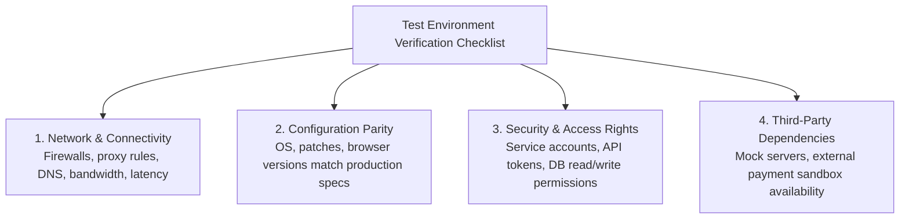
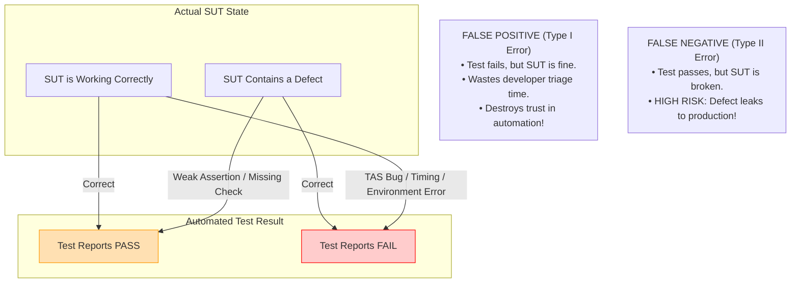
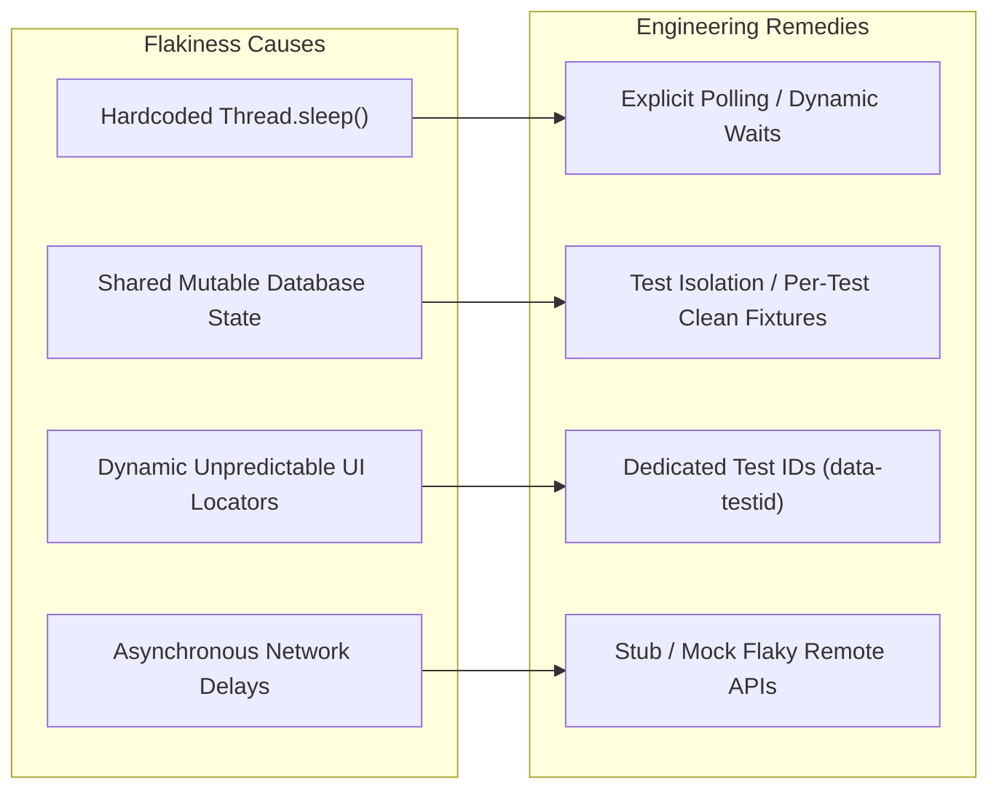
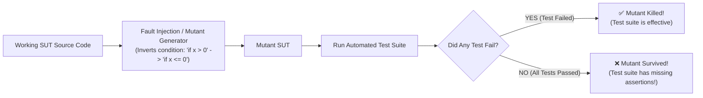
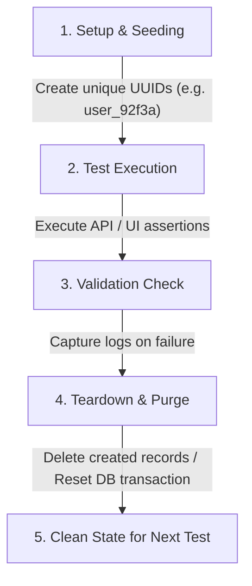

# 🛡️ Priority 1: Chapter 7 — Verifying the Test Automation Solution (TAS)

> **Exam Weight:** 🔴 **HIGH (~4-5 Questions / ~12% of Total Exam)**  
> **Cognitive Level:** **K2, K3** (Verifying environment, detecting flakiness, diagnosing false results)

---

## 🎯 What You'll Learn
1. How to verify all components of the **Automated Test Environment**.
2. How to identify, diagnose, and eliminate **False Positives** and **False Negatives**.
3. Causes and cures for **Test Flakiness** (Non-deterministic tests).
4. Techniques for **"Testing the Tests"** (Fault Injection & Mutation Testing).
5. Safe **Test Data Management** strategies in parallel execution.

---

## 1. Verifying Automated Test Environment Components

Before trusting automation test results, the TAE must verify that the execution environment is sound:



> [!IMPORTANT]
> **Exam Tip (K2):** If an automated test suite reports mass failures on Monday morning, the TAE must first verify the **Test Environment and TAS prerequisites** before filing defects against the SUT.

---

## 2. False Positives vs False Negatives

Understanding the distinction and consequences of false test results is a core exam topic:



### Side-by-Side Comparison

| Metric | False Positive (False Alarm) | False Negative (Missed Defect) |
| :--- | :--- | :--- |
| **What Happened?** | Test reported **FAIL**, but the SUT is working fine. | Test reported **PASS**, but the SUT contains a bug. |
| **Root Cause** | Brittle locator, network timeout, unhandled race condition, hardcoded sleep expired, dirty test data. | Incomplete assertion (e.g., checked status 200 but didn't verify response body payload), wrong expected value. |
| **Business Impact** | High triage overhead; leads to team ignoring automation results (*"Cry Wolf syndrome"*). | **Catastrophic**: Critical bugs reach production undetected. |

---

## 3. Root Causes & Fixes for Test Flakiness

A **flaky test** is a test that exhibits both a pass and a fail outcome when executed multiple times against the exact same unchanged code.



### Code Example: Eliminating Sleep Flakiness

```python
# ❌ ANTI-PATTERN: Brittle, flaky, slow
def test_user_profile_bad(driver):
    driver.find_element("id", "btn-save").click()
    import time
    time.sleep(5)  # Fails if network takes 5.1s; wastes 4s if network takes 1s!
    assert "Saved" in driver.page_source

# ✅ BEST PRACTICE: Deterministic explicit condition polling
from selenium.webdriver.support.ui import WebDriverWait
from selenium.webdriver.support import expected_conditions as EC

def test_user_profile_good(driver):
    driver.find_element("id", "btn-save").click()
    
    # Polls DOM every 200ms up to 10s maximum; proceeds immediately once ready!
    badge = WebDriverWait(driver, 10).until(
        EC.visibility_of_element_located(("id", "save-confirmation-badge"))
    )
    assert badge.text == "Saved"
```

---

## 4. Testing the Tests: Mutation Testing & Fault Injection

How does the TAE verify that the automated test suite actually catches bugs?



- **Mutation Testing:** Automatically introduces deliberate syntactic faults into the application code to measure whether existing automated tests detect them.
- **Mutant Killed:** Good! The automated test suite caught the deliberate defect.
- **Mutant Survived:** Bad! The test suite ran and passed despite the defect, revealing a hole in test assertions.

---

## 5. Test Data Lifecycle & Isolation



### Parallel Execution Data Isolation Rules:
1. **Never share mutable data** between concurrent threads (e.g., two tests modifying the same test user's balance simultaneously).
2. Use **dynamic data generation** with unique identifiers (e.g., `test_user_<timestamp>@test.com`) rather than fixed static accounts.
3. Isolate database states using **database transactions with automatic rollback** after each test.

---

## 6. ❓ Typical Exam Scenarios (K3)

### 🚨 Scenario 1: Diagnosing Mass Monday Failures
> **Scenario:** On Monday morning, 95% of tests in the nightly regression suite failed with `ConnectionTimeoutException`. The application code had not been updated over the weekend.
>
> **What should the TAE investigate first?**  
> A) Rewrite all test locators  
> B) File 95 critical defect tickets against the development team  
> C) Verify the test environment network connectivity, service availability, and expired auth certificates  
> D) Delete the failed tests from the suite  
>
> **Correct Answer:** **C.** A systemic timeout across 95% of tests with no code changes indicates an environmental outage, network firewall issue, or expired credential in the test execution environment.

---

### 🚨 Scenario 2: High False Positive Rate
> **Scenario:** Developers complain that the automated regression run takes 3 hours to triage every morning because 40 tests fail daily due to UI animation lag, even though the application functions properly when manually checked.
>
> **What is the root problem and required resolution?**  
> **Correct Answer:** The suite suffers from a **high False Positive rate** caused by improper synchronization. The TAE must replace arbitrary sleeps and static timeouts with **explicit dynamic waits** and stable component selectors.
