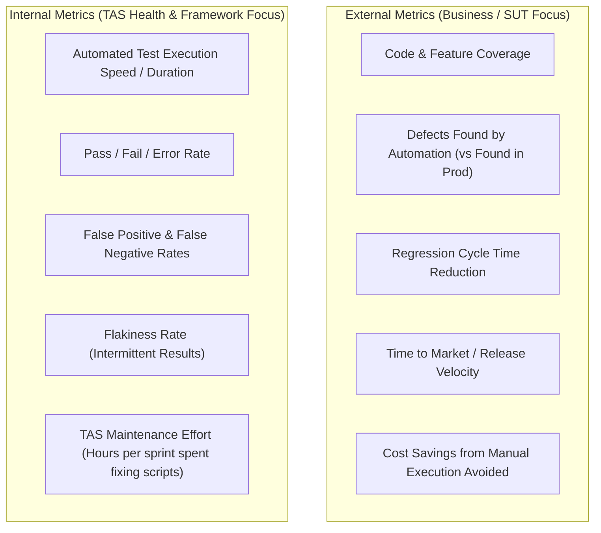
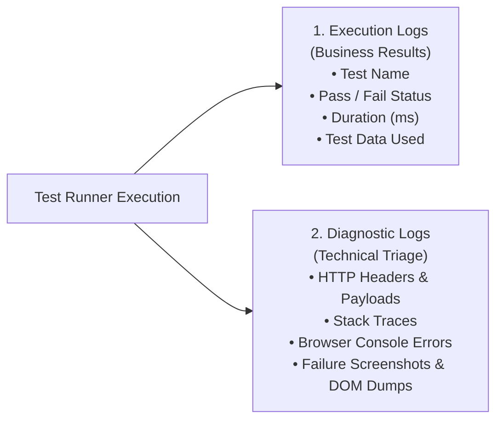
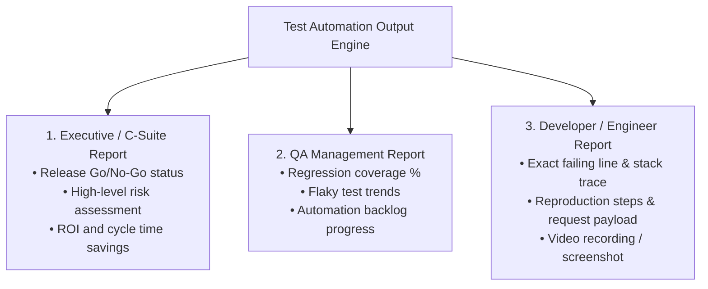

# 📊 Priority 2: Chapter 5 — Test Automation Reporting & Metrics

> **Exam Weight:** 🟡 **MEDIUM (~4-5 Questions / ~12% of Total Exam)**  
> **Cognitive Level:** **K2, K3** (Selecting metrics, interpreting logs, stakeholder-targeted reporting)

---

## 🎯 What You'll Learn
1. The difference between **External (Business) Metrics** and **Internal (TAS) Metrics**.
2. How to measure **Defect Detection Effectiveness**, **Execution Duration**, and **Flakiness Rate**.
3. The distinction between **Diagnostic Logs** and **Execution Logs**.
4. How to tailor reporting for different audiences (Executives, Developers, QA Leads).

---

## 1. External vs Internal Metrics

The CTAL-TAE exam tests your ability to distinguish between metrics measuring business value (External) and metrics measuring framework health (Internal):

### Metrics Comparison Table

| Metric Category | Metric Name | What It Measures | Target Direction |
| :--- | :--- | :--- | :---: |
| **External** | **Defect Detection Rate** | Percentage of total software bugs discovered by automation before release. | ⬆️ Higher |
| **External** | **Time-to-Feedback** | How quickly developers learn if a commit broke regression. | ⬇️ Lower |
| **Internal** | **False Alarm Rate** | Percentage of test failures caused by TAS bugs/flakiness rather than real SUT defects. | ⬇️ Zero |
| **Internal** | **Automation Maintenance Ratio** | Ratio of time spent maintaining scripts vs creating new tests. | ⬇️ Lower |
| **Internal** | **Execution Pass Rate** | Percentage of completed tests passing deterministically. | ⬆️ High |

---

## 2. Diagnostic Logs vs Execution Logs

A robust TAS must generate two completely distinct streams of log information:

| Dimension | Execution Logs | Diagnostic Logs |
| :--- | :--- | :--- |
| **Target Audience** | QA Managers, Release Managers, Product Owners | Automation Engineers, Developers debugging failures |
| **Contents** | High-level test status, start/end time, overall pass rate | Raw stack traces, SQL queries, network HAR files, screenshots |
| **Verbosity** | Concise, summary tables | Verbose, detailed timestamps and thread IDs |
| **Retention** | Long-term trend analysis (stored for months) | Short-term triage (stored until bug is resolved) |

---

## 3. Stakeholder-Targeted Reporting

One report does **not** fit all stakeholders. The exam tests matching report content to the appropriate audience:

---

## 4. ❓ Typical Exam Scenarios (K2/K3)

### 🚨 Scenario 1: Misleading Metrics
> **Scenario:** A manager celebrates because the test automation team achieved a **99.8% pass rate** every night for 6 months. However, during the same period, customer-reported production defects increased by 40%.
>
> **What does this indicate about the TAS metrics?**  
> **Correct Answer:** The test suite suffers from **high False Negatives or weak assertions**. The tests are passing because they are not asserting meaningful business rules, creating a false sense of security while defects leak into production.

---

### 🚨 Scenario 2: Selecting Appropriate Reporting
> **Scenario:** After a nightly run of 3,000 automated tests, who should receive the raw console output containing 10,000 lines of driver debug logs?
>
> A) The VP of Engineering  
> B) The Product Owner  
> C) The Test Automation Engineer investigating failures  
> D) The Customer Support team  
>
> **Correct Answer:** **C.** Highly detailed technical diagnostic logs are intended specifically for the technical personnel responsible for triaging and repairing test execution failures.
