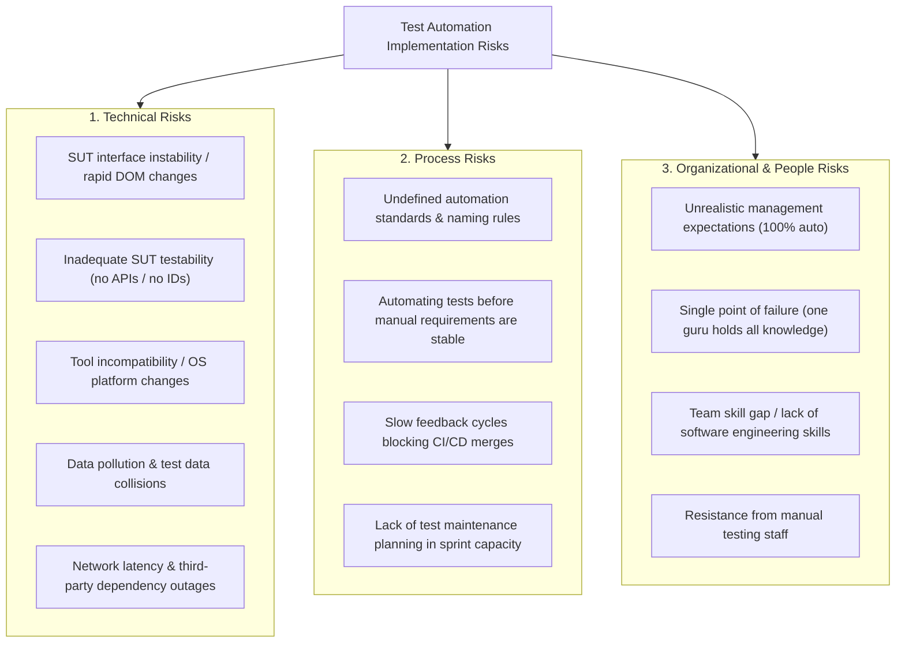
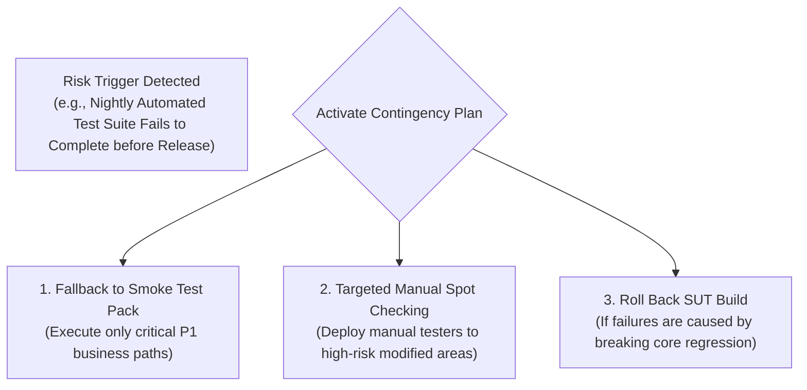

# ⚠️ Priority 2: Chapter 4 — Implementation Risks & Contingencies

> **Exam Weight:** 🟡 **MEDIUM (~4-5 Questions / ~10% of Total Exam)**  
> **Cognitive Level:** **K3, K4** (Risk identification, risk assessment matrix, contingency design)

---

## 🎯 What You'll Learn
1. The 3 categories of automation risks: **Technical**, **Process**, and **Organizational/People**.
2. How to assess probability vs impact and design **Risk Mitigation Strategies**.
3. How to build actionable **Contingency Plans** for critical delivery roadblocks.
4. How to protect an organization from **Vendor Lock-in**.

---

## 1. Test Automation Risk Taxonomy

Automation is not without risk. The CTAL-TAE exam categorizes implementation risks into three distinct areas:

---

## 2. Risk Assessment & Mitigation Matrix

| Identified Risk | Risk Category | Severity | Proactive Mitigation Strategy |
| :--- | :---: | :---: | :--- |
| **Volatile SUT UI** | Technical | High | Shift tests to API/service layer; decouple test logic using the Page Object Model. |
| **Unrealistic Management Expectations** | Organizational | High | Set explicit goals early (e.g. 70% regression coverage, not 100%); present realistic ROI timelines. |
| **Key Engineer Turnover ("Bus Factor")** | Organizational | Medium | Mandate code reviews, comprehensive architecture documentation, and paired automation sprints. |
| **Vendor Lock-in** | Technical | High | Encapsulate proprietary tool calls within the **Test Adaptation Layer (Layer 4)** using open interfaces. |
| **Test Execution Bottleneck** | Process | High | Implement parallel test execution, containerized runners (Docker), and test suite tagging (Smoke vs Full). |

---

## 3. Contingency Planning

A **Contingency Plan** is an alternative course of action activated when an identified risk manifests into an active blocker:

> [!IMPORTANT]
> **Exam Tip (K4):** Mitigation is **proactive** (done before the risk occurs). Contingency is **reactive** (pre-planned action executed after the risk occurs).

---

## 4. ❓ Typical Exam Scenarios (K3/K4)

### 🚨 Scenario 1: Mitigating Vendor Lock-in
> **Scenario:** An organization is purchasing a commercial, closed-source test automation tool. The CTO is concerned that if license prices increase by 200% next year, the company will be trapped because rewriting tests will cost millions.
>
> **Which architectural strategy mitigates this risk?**  
> **Correct Answer:** **Adhere strictly to gTAA Layer 4 separation.** Ensure all tests are authored in the Test Definition Layer (using standard keywords, Gherkin, or business methods) and only interact with the commercial tool via dedicated adapters. If the tool is replaced, only the adapters in the Test Adaptation Layer are rewritten.

---

### 🚨 Scenario 2: Unstable SUT Requirements
> **Scenario:** A team is building a new fintech mobile app. Features and user interfaces are changing daily in fast iterations. Management demands that automation start immediately for all new screens.
>
> **What risk should the TAE highlight?**  
> **Correct Answer:** **Premature Automation Risk.** Automating against an unstable, rapidly changing UI will cause immense script maintenance overhead, rendering the automation efforts useless and resulting in a negative ROI. Automation should focus on stable API layers and mature regression features first.
