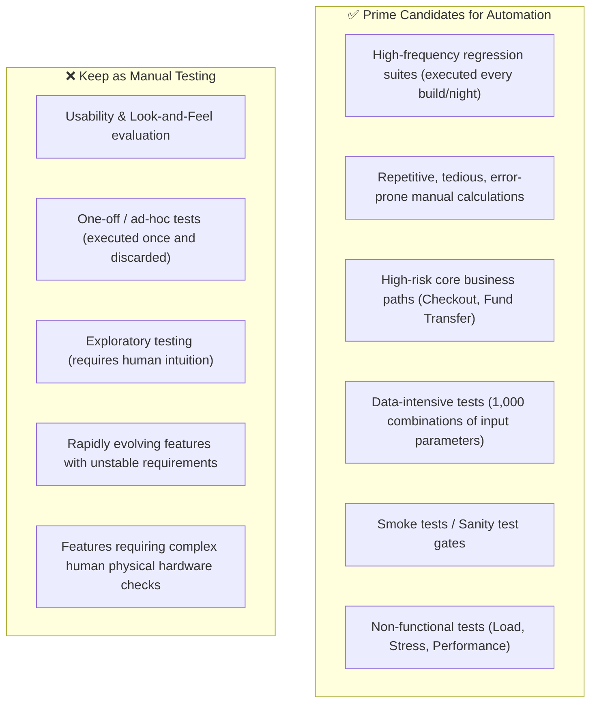
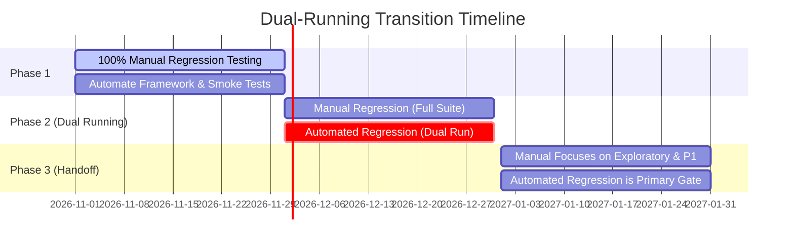

# 🔄 Priority 2: Chapter 6 — Transitioning Manual Testing to an Automated Environment

> **Exam Weight:** 🟡 **MEDIUM (~3-4 Questions / ~9% of Total Exam)**  
> **Cognitive Level:** **K2, K3** (Selecting candidates for automation, phased rollout, dual-running)

---

## 🎯 What You'll Learn
1. How to distinguish between tests that **should** and **should not** be automated.
2. The **Feasibility vs Business Value** selection quadrant.
3. How to execute a safe **Phased Automation Rollout**.
4. The purpose and exit criteria of **Dual-Running (Parallel Execution)**.

---

## 1. What to Automate vs What NOT to Automate



---

## 2. Prioritization Quadrant: Feasibility vs Value

```mermaid
quadrantChart
    title Automation Candidate Selection Matrix
    x-axis Low Technical Feasibility --> High Technical Feasibility
    y-axis Low Business Value --> High Business Value
    quadrant-1 🚀 Automate Immediately (P1)
    quadrant-2 🔍 Automate via API / Refactor
    quadrant-3 🛑 Do Not Automate (Waste)
    quadrant-4 ⏳ Automate If Low Hanging Fruit
    "Core Payment Flow": [0.85, 0.90]
    "User Login & Auth": [0.90, 0.85]
    "Search & Filter": [0.75, 0.70]
    "Complex Legacy Grid UI": [0.25, 0.85]
    "About Us Page Typos": [0.80, 0.15]
    "One-time Marketing Promo": [0.15, 0.10]
```

---

## 3. The Dual-Running Strategy

During transition, manual testing cannot simply be turned off overnight. The organization executes **Dual-Running**:



### Purpose of Dual-Running:
- Compare automated test results with manual test results side-by-side.
- Calibrate false positive/negative rates without jeopardizing release quality.
- Build stakeholder trust in the automated test results.

### Exit Criteria for Dual-Running:
1. Automated suite runs reliably for several consecutive cycles with **zero unexplained failures**.
2. Automated test results match manual results with 100% agreement.
3. Execution time is significantly faster than the manual cycle.

---

## 4. ❓ Typical Exam Scenarios (K2/K3)

### 🚨 Scenario 1: Candidate Selection
> **Scenario:** A team has a regression pack of 200 manual test cases. Due to limited time, they can only automate 50 tests this month.
>
> **Which tests should be automated first?**  
> A) Tests that verify aesthetic font styles on the homepage  
> B) Complex tests that are run once a year for compliance  
> C) High-frequency smoke tests covering critical revenue transactions  
> D) Tests that fail intermittently when executed manually  
>
> **Correct Answer:** **C.** Critical revenue paths with high execution frequency provide the fastest return on investment and risk reduction.

---

### 🚨 Scenario 2: Stopping Dual-Running
> **Scenario:** A QA manager wants to discontinue manual regression and rely solely on the new automated suite. Under what condition is this transition justified?
>
> **Correct Answer:** When dual-running has demonstrated that the automated suite is **stable, deterministic, exhibits minimal false positives, and reliably detects defects** over multiple consecutive sprint releases.
