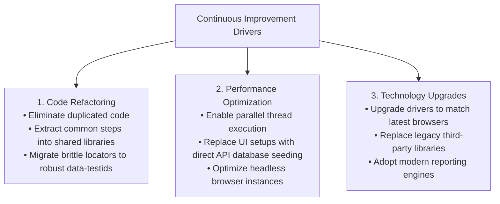
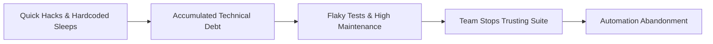
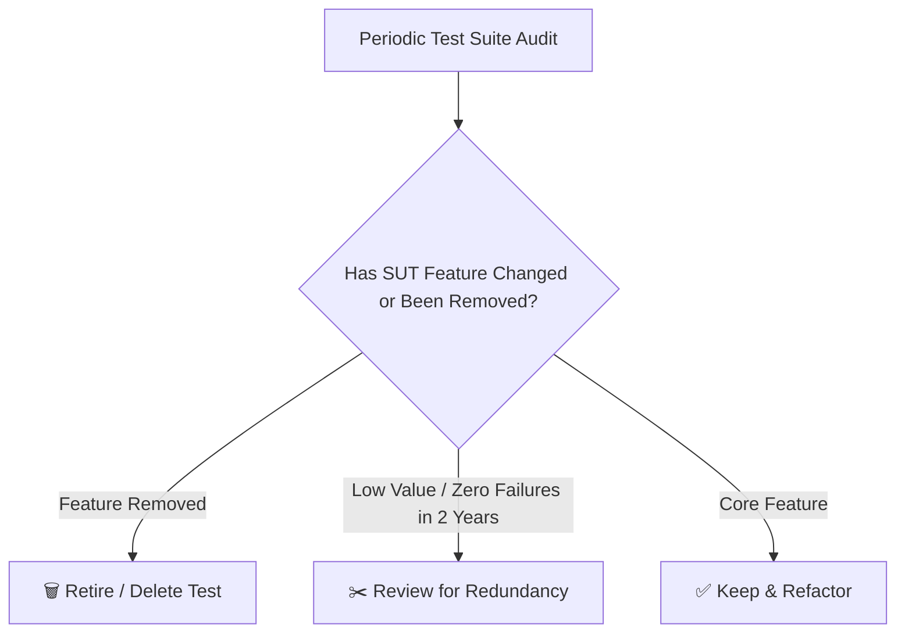

# 🔄 Priority 3: Chapter 8 — Continuous Improvement of the TAS

> **Exam Weight:** 🟢 **FOUNDATIONAL (~3-4 Questions / ~9% of Total Exam)**  
> **Cognitive Level:** **K2, K3** (Refactoring TAS, handling technical debt, deprecating & retiring tests)

---

## 🎯 What You'll Learn
1. Strategies for ongoing **TAS Maintenance and Refactoring**.
2. How to measure and pay down **Automation Technical Debt**.
3. Best practices for **Retiring and Deprecating** obsolete automated tests.
4. Framework optimization techniques to keep execution times under control.

---

## 1. Options for Improving the TAS

A Test Automation Solution degrades over time unless continuously maintained:

---

## 2. Managing Automation Technical Debt

Just like production application code, automation code accumulates **technical debt** if corners are cut:

### Techniques to Prevent Technical Debt:
- **Mandatory Code Reviews:** All new automation scripts must undergo peer review before merging.
- **Dedicated Maintenance Allocation:** Reserve 15-20% of every sprint's automation capacity for refactoring and framework health.
- **Static Code Analysis:** Run linters (e.g., Flake8, ESLint, SonarQube) against test automation codebases.

---

## 3. Retiring and Deprecating Tests

Automated suites should **not grow infinitely**. As SUT features evolve, tests must be actively curated:

### When to Retire an Automated Test:
1. The corresponding feature has been removed or deprecated in the SUT.
2. The test duplicates coverage already validated by lower-level unit or API tests (reducing execution bloat).
3. The maintenance cost of the test consistently exceeds the business risk of the feature it guards.

---

## 4. ❓ Typical Exam Scenarios (K2/K3)

### 🚨 Scenario 1: Uncontrollable Execution Times
> **Scenario:** Over 2 years, a company's UI automated regression suite has grown to 1,200 tests. The suite now takes 9 hours to run, preventing developers from receiving timely feedback on pull requests.
>
> **Which continuous improvement actions should the TAE take?**  
> **Correct Answer:**
> 1. Run tests in **parallel** across multiple containerized nodes.
> 2. Replace slow UI prerequisite steps (e.g., UI registration and login) with **fast API calls or direct database seeding**.
> 3. Audit the suite to **retire redundant tests** covered at unit/API levels.

---

### 🚨 Scenario 2: Refactoring Decision
> **Scenario:** When should an automation team schedule refactoring of their Page Objects and utility classes?  
> **Correct Answer:** Continuously throughout the development lifecycle, as part of regular sprint activities, whenever duplication or maintenance friction is detected.
