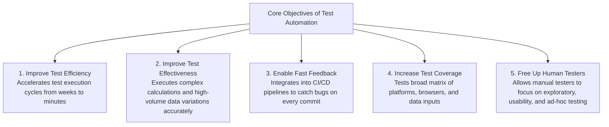

# 🎯 Priority 3: Chapter 1 — Introduction & Objectives for Test Automation

> **Exam Weight:** 🟢 **FOUNDATIONAL (~3-4 Questions / ~8% of Total Exam)**  
> **Cognitive Level:** **K2** (Understanding purposes, advantages, disadvantages, success factors)

---

## 🎯 What You'll Learn
1. The formal **Objectives** of Test Automation.
2. The realistic **Advantages** and **Disadvantages / Limitations** of automation.
3. Crucial **Success Factors** for long-term automation viability.
4. Common automation myths and misconceptions tested on the exam.

---

## 1. Purpose & Objectives of Test Automation

---

## 2. Advantages vs Disadvantages & Limitations

| Advantages of Automation | Disadvantages & Limitations |
| :--- | :--- |
| **Speed:** Executes repetitive tests drastically faster than manual testing. | **High Initial Cost:** Significant upfront investment in tools, design, and script development. |
| **Consistency:** Eliminates human fatigue, oversight, and execution mistakes. | **Ongoing Maintenance:** Scripts break whenever SUT interfaces or data change. |
| **Reusability:** Scripts can run indefinitely across builds, versions, and environments. | **Cannot Find All Bugs:** Tests only assert what they are programmed to check (Pesticide Paradox). |
| **Coverage:** Enables tests with thousands of parameter combinations (DDT). | **Cannot Replace Human Intuition:** Unsuitable for usability, aesthetics, and exploratory testing. |

> [!WARNING]
> **Exam Trap (K2):** Test automation **does NOT eliminate manual testing**! It replaces repetitive regression execution, allowing manual testers to focus on high-value cognitive testing.

---

## 3. Success Factors in Test Automation

According to the ISTQB syllabus, a successful TAS depends on these foundational factors:

1. **Treat Automation as Software Development:** Apply version control, code reviews, coding standards, and modular architecture.
2. **Clear & Realistic Objectives:** Define measurable goals (e.g., reduce smoke test cycle time from 4 hours to 10 minutes) rather than vague promises like *"automate everything"*.
3. **Design for Testability:** Developers must build identifiable UI locators (`data-testid`), clear APIs, and database reset hooks.
4. **Skilled Team:** Ensure team members possess adequate engineering and programming competencies.
5. **Decoupled Architecture (gTAA):** Separate test generation, definition, execution, and adaptation layers to protect tests from technical changes.

---

## 4. ❓ Typical Exam Scenarios (K2)

### 🚨 Scenario 1: Misconception About Defect Detection
> **Scenario:** Which of the following is a **valid limitation** of automated regression testing?
>
> A) Automated tests can only detect defects in areas they are explicitly programmed to verify  
> B) Automated tests cannot be run at night  
> C) Automated tests execute slower than manual testing  
> D) Automated tests cannot be integrated into CI/CD pipelines  
>
> **Correct Answer:** **A.** Automated tests follow pre-scripted assertions; if a visual bug occurs outside the asserted elements, the script will pass without noticing it.

---

### 🚨 Scenario 2: Justifying Automation to Management
> **Scenario:** What is the primary business justification for introducing test automation in an agile environment with weekly releases?
>
> **Correct Answer:** To provide **rapid, repeatable regression feedback** on new builds without delaying sprint delivery, while freeing up manual testers for exploratory testing of new user stories.
